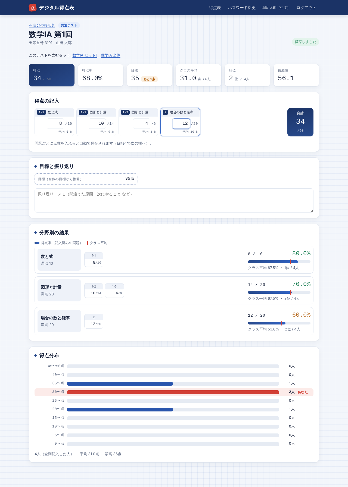

# デジタル得点表（point-checker）

紙の「得点表」「分野別チェック」で行っている得点記入を、Web上で行うためのアプリです。
Firebase（Hosting・Authentication・Firestore）で動きます。ビルド作業は不要です。



## できること

### 生徒
- **ログイン**：ユーザー名とパスワードでログインします。初回は先生から受け取った仮パスワードを自分のパスワードに変更します。
- **得点表への記入**：紙と同じ「セット → 回 → 問題（番号・分野・配点）」の形で点数を入力します。入力すると自動で保存されます。
- **自動計算**：小計とセット合計を自動で計算します。セットごとの目標点・振り返りメモ・最終目標も書けます。
- **クラス内での比較**：問題ごとの平均点、回とセットの平均・順位、全体の得点率・順位・偏差値を表示します。
- **分野別チェック**：分野ごとの得点・得点率を一覧にし、クラス平均と並べて表示します。
- **過去の記録**：トップページに得点表ごとの進み具合と、最近の記録の一覧を表示します。

### 教師
- **得点表の作成**：得点表の名前、分野、セット、回、問題（問題番号・分野・配点）を自由に作れます。同じ構成の回は「複製」で作れます。
- **公開の切り替え**：得点表を生徒に公開するか、非公開にするかを選べます。
- **成績一覧**：全生徒の成績を「回別・セット別・分野別」で表示し、リアルタイムで更新されます。組で絞り込みや、得点率順での並べ替えができます。
- **個人の記録**：生徒の名前を押すと、その生徒の得点表（目標・振り返りメモを含む）を見られます。
- **CSV出力**：問題ごとの点数・小計・合計・分野別の得点率をCSVで出力できます。
- **アカウント管理**：生徒アカウントを一括作成できます（初期パスワードは自動で作られます）。組・番号・名前の編集、削除もできます。
- **登録コード**：生徒が自分でアカウントを作るときの「登録コード」を設定できます。

## ファイル構成

```
public/              ← Firebase Hosting で公開するファイル
  index.html
  app.css
  app.js             ← 画面と処理
  stats.js           ← 集計（平均・順位・得点率）
  firebase-config.js ← ★ 自分の Firebase の設定を書く
firestore.rules      ← セキュリティルール（誰が何を読める・書けるか）
firebase.json
.github/workflows/deploy.yml ← main への push で自動デプロイ
functions/           ← 任意: パスワード再発行用の Cloud Functions（Blaze プランが必要）
```

## セットアップ手順

Firebase プロジェクトは `point-check-9ca84` です。設定値は `public/firebase-config.js` に書き込み済みです。
公開後のURLは **https://point-check-9ca84.web.app** になります。

### 1. Firebase プロジェクト
プロジェクトとウェブアプリの登録は完了しています。Google アナリティクスは、このアプリでは使いません。

### 2. ログイン方法を有効にする
「Authentication」→「始める」→「Sign-in method」で **メール / パスワード** を有効にします。

アプリ内ではメールアドレスを使いません。ユーザー名を `ユーザー名@score-note.local` という形に変換して内部で使います。

### 3. Firestore を作る
「Firestore Database」→「データベースを作成」で作成します。

- ロケーション：`asia-northeast1`（東京）がおすすめです。
- モード：本番環境モードを選びます（ルールは後でデプロイします）。

### 4. デプロイする

#### A. GitHub から自動でデプロイする（おすすめ）
`main` ブランチに push するたびに、GitHub Actions（`.github/workflows/deploy.yml`）が Hosting と Firestore ルールをデプロイします。
最初に一度だけ、Firebase へのデプロイに使う鍵を GitHub に登録します。

1. Firebase コンソール → ⚙「プロジェクトの設定」→「サービス アカウント」→「新しい秘密鍵を生成」で JSON ファイルをダウンロードします。
2. GitHub のリポジトリ → Settings → Secrets and variables → Actions → **New repository secret** を開きます。
   - 名前：`FIREBASE_SERVICE_ACCOUNT`
   - 値：ダウンロードした JSON の中身をすべて貼り付けます。
3. Google Cloud の IAM（https://console.cloud.google.com/iam-admin/iam?project=point-check-9ca84）で、鍵のサービスアカウント（`firebase-adminsdk-…`）に「Firebase ルール管理者」のロールを追加します（Firestore ルールのデプロイに必要）。
4. Actions タブで「Firebase にデプロイ」を選び、**Run workflow** を押します（以降は push するたびに自動で動きます）。

ダウンロードした鍵ファイルはプロジェクトの管理者権限を持つので、リポジトリには入れず、登録後は削除してください。

#### B. 自分のパソコンからデプロイする
```bash
npm install -g firebase-tools
firebase login
firebase deploy --only hosting,firestore:rules
```

### 5. 登録コードを設定し、最初の教師アカウントを作る
1. Firebase コンソールの「Firestore Database」でコレクション `config` を作ります。
2. その中にドキュメントID `secret` のドキュメントを作り、次の2つのフィールド（文字列）を入れます。
   - `teacherCode`：教師用の登録コード（例：`t-xxxx`。推測されにくいものにする）
   - `studentCode`：生徒用の登録コード（自己登録を使わないなら空欄）
3. アプリを開き、「登録コードで新規登録」から「教師として登録する」にチェックを入れて登録します。
4. 教師がそろったら、アプリの「生徒・アカウント」画面で教師用の登録コードを空欄にしておくと安全です。

## 使い方の流れ

1. **得点表を作る**（教師）
   トップページで得点表を作り、「構成を編集」で分野 → セット → 回 → 問題（番号・分野・配点）の順に入力して保存します。
   準備ができたら「生徒に公開する」を押します。
2. **生徒のアカウントを作る**（教師）
   「生徒・アカウント」で「組,番号,名前,ユーザー名」を1行に1人ずつ貼り付けて作成します。
   表示された初期パスワードの一覧をコピーかCSVで保存し、生徒に配ります。
   生徒用の登録コードを使って、生徒に自分で登録してもらうこともできます。
3. **点数を記入する**（生徒）
   ログインして得点表を開き、点数を入力します。入力すると自動で保存されます。
4. **成績を確認する**（教師）
   「成績一覧」で全員の成績を確認します。名前を押すと、その生徒の得点表を見られます。

## 集計のルール
- **得点率**：記入済みの問題の得点 ÷ 記入済みの問題の満点です。進み具合が違う生徒どうしでも比べられるようにしています。
- **回・セットの平均と順位**：その回・セットを全問記入した生徒どうしで比べます。
- **分野・全体の順位**：その分野・全体で1問以上記入した生徒の得点率で比べます。
- **偏差値**：50 + 10 ×（自分 − 平均）÷ 標準偏差で計算します。同点の場合は同じ順位になります。
- 教師は集計に含みません。

## データとプライバシー

| データ | 生徒本人 | 他の生徒 | 教師 |
|---|---|---|---|
| 名前・組・番号（`users`） | 読める | **読めない** | 読み書きできる |
| 点数（`scores`） | 読み書きできる | 名前なしで読める※ | 読める |
| 目標・振り返りメモ（`notes`） | 読み書きできる | **読めない** | 読める |
| 得点表の構成（`workbooks`） | 公開中のものを読める | 同左 | 読み書きできる |
| 登録コード（`config/secret`） | 読めない | 読めない | 読み書きできる |

※ 平均点・順位をブラウザ側で計算するため、点数データは名前を含まない形で他の生徒からも読める設定です。画面には他の人の点数は表示しません。
これも見せたくない場合は、集計を Cloud Functions で行う構成に変更できます（Blaze プランが必要）。

## 任意: パスワード再発行（Cloud Functions）
無料の Spark プランのままでは、教師画面からパスワードを再発行できません。

**再発行できるようにする場合**（Blaze プランが必要。この用途なら通常は無料枠内に収まります）：
```bash
cd functions && npm install && cd ..
firebase deploy --only functions
```
デプロイ後、`public/firebase-config.js` の `functionsEnabled` を `true` にして、もう一度 `firebase deploy --only hosting` を実行します。
「生徒・アカウント」画面に「パスワード再発行」ボタンが出るようになります。アカウントを削除したときに、ログイン情報も一緒に消えるようになります。

**Functions を使わない場合**：
1. Firebase コンソールの Authentication でその生徒を削除します。
2. アプリで同じユーザー名のアカウントを作り直します。

この場合、以前の記録は引き継がれません。

## ローカルで試す（エミュレーター）
```bash
firebase emulators:start --only auth,firestore,hosting --project demo-score
```
- `http://localhost:5000` を開くと、自動でエミュレーターに接続されます。
- 登録コードは、エミュレーターUI（`http://localhost:4000`）の Firestore で `config/secret` を作って設定します。
- エミュレーターを使うには Java が必要です。
